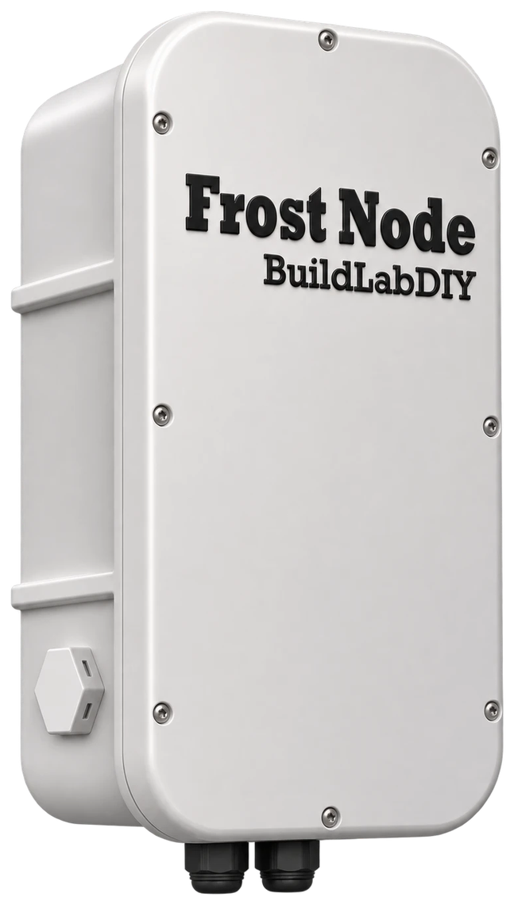

## Device info

**PCB_Board**: BuildLab Frost Node, стационарная нода с солнечной панелью

**MCU**: ESP32-S3 N16R8 (16 МБ flash, 8 МБ PSRAM)

**LORA_Board**: EByte E22-900M30S или E22P-868M30S

**Power**: одна ячейка LTO, заряд от солнечной панели через CN3795, контроль питания INA3221 (0x42)

**LINKS**: [Variant](https://github.com/mrekin/MeshtasticCustomBoards/tree/main/firmware/variants/esp32s3/diy/buildlab_frost_node)

## Notes

**Прошивки** отличаются шунтом третьего канала INA3221 и модулем: «BuildLab Frost Node» (E22-900M30S, шунты 10/10/10 мОм), «BuildLab Frost Node 100 mOhm» (E22-900M30S, 10/10/100 мОм) и «BuildLab Frost Node E22P» (E22P-868M30S, 10/10/10 мОм). Выбирайте по модулю и номиналу шунта на своей плате.

**E22P**: вывод 6 модуля (GPIO17) это EN, держится в HIGH; вывод 7 (GPIO16) это T/R, HIGH на передачу.

**Каналы INA3221**: CH1 вход солнечной панели, CH2 выход зарядника на ячейку и нагрузку, CH3 нагрузка от ячейки.

**Батарея** считается по INA3221, канал CH2: напряжение ячейки и заряд/разряд по знаку тока. Шкала процентов построена по полному разряду ячейки на Frost Node: 2.50 В = 100 %, 1.90 В (отсечка защиты ячейки) = 0 %.

**Настройки при первом включении** (чистая память или после сброса): батарея с INA3221 и телеметрия питания (все три канала) включены. Плата один раз перезагружается. Регион и мощность не меняются.

**Contacts**: Telegram [@BuildLabDIY](https://t.me/BuildLabDIY)
